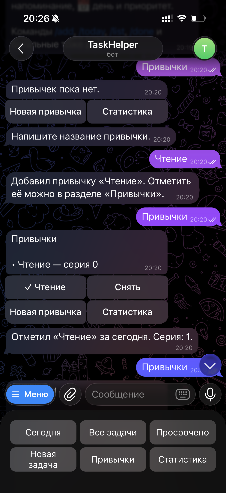
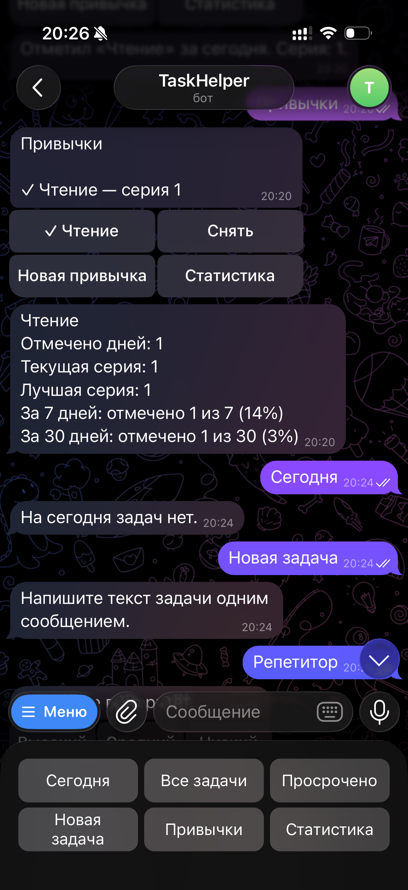
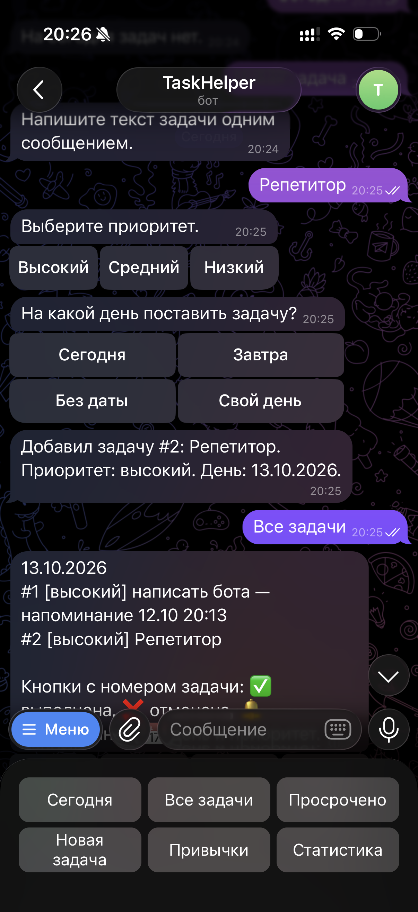
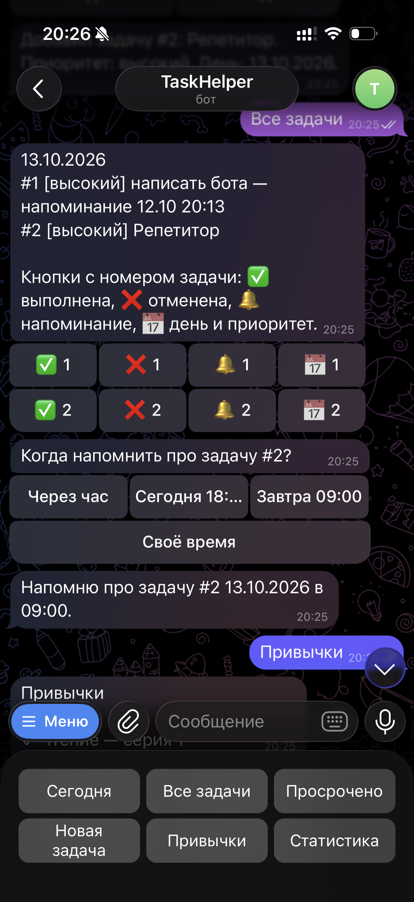

University: [ITMO University](https://itmo.ru/ru/)
Faculty: [FICT](https://fict.itmo.ru)
Course: [Vibe Coding: AI-боты для бизнеса](https://github.com/itmo-ict-faculty/vibe-coding-for-business)
Year: 2025/2026
Group: U4225
Author: Matsukov Artem Sergeevich
Lab: Lab1
Date of create: 12.10.2026
Date of finished:

# Лабораторная работа 1. Создание первого Telegram-бота без программирования

## Описание задачи

Бот — личный ассистент дел и привычек. Он принимает задачи текстом, назначает их на конкретный день, раскладывает по приоритету, напоминает в заданное время и ведёт трекер привычек. Отдельно считает статистику по выполненным, отменённым и просроченным задачам и по привычкам.

Проблема: задачи и привычки теряются в переписке и заметках, не видно, что просрочено и какая привычка держится. Бот собирает это в одном чате Telegram.

Задача выбрана как вариант «бот-ассистент для задач» из условия лабораторной: приём задач текстом, приоритеты, напоминания и списки дел. День выполнения, отмена, просрочка, трекер привычек и статистика добавлены, чтобы бот закрывал ежедневный сценарий, а не только список без дат.

### Задачи

- `/add [приоритет] текст [ДД.ММ]` — новая задача. Приоритет: высокий, средний, низкий. Если не указан, ставится средний. Дата назначает задачу на этот день. Без даты задача остаётся во входящих.
- `/date номер ДД.ММ` — назначить или перенести задачу на день.
- `/today` — дела на сегодня.
- `/day ДД.ММ` — дела на выбранный день.
- `/list` — все активные: сначала входящие, затем по дням, внутри дня по приоритету.
- `/priority номер уровень` — сменить приоритет.
- `/remind номер ЧЧ:ММ` или `/remind номер ДД.ММ ЧЧ:ММ` — напоминание. После перезапуска бот восстанавливает его из файла.
- `/done номер` — выполнена.
- `/cancel номер` — отменена. В статистике отмена и удаление различаются.
- `/delete номер` — удалить без следа в статистике.
- `/overdue` — активные задачи, у которых день выполнения раньше сегодняшнего.

Просрочка: день задачи уже прошёл, статус всё ещё «активна». Выполненные и отменённые в просрочку не попадают. Задача на сегодня просроченной не считается.

### Привычки

- `/habit название` — новая привычка.
- `/habits` — список: отмечена ли сегодня, текущая серия дней.
- `/check название` — отметить выполнение за сегодня. Повторная отметка в тот же день не дублируется.
- `/uncheck название` — снять сегодняшнюю отметку.
- `/habitstats` — по каждой привычке: сколько дней отмечено, текущая серия, лучшая серия, доля дней за последние 7 и 30 дней.

### Статистика задач

`/stats` показывает число активных, выполненных, отменённых и просроченных задач и короткую сводку по привычкам.

### Кнопки

После проверки командами боту добавили кнопки, чтобы на защите не вспоминать синтаксис. Внизу чата шесть кнопок: «Сегодня», «Все задачи», «Просрочено», «Новая задача», «Привычки», «Статистика». Новая задача спрашивает текст, затем приоритет и день. Под списком у номера задачи есть кнопки: выполнена, отменена, напоминание, день и приоритет. У привычки есть отметка на сегодня, снятие отметки, создание новой и статистика. Команды при этом не убирались.

### Хранение и ошибки

Данные чата лежат в `tasks.json`: задачи (номер, текст, приоритет, день, напоминание, статус, дата создания) и привычки (название, даты отметок). Чужой чат эти записи не видит. Неверный номер, пустая команда или неверная дата дают понятный ответ, бот при этом не останавливается.

## Промпт для LLM

### Исходный промпт

```text
Создай Telegram-бота на Python с использованием библиотеки python-telegram-bot (версия 21 или новее, асинхронный Application и JobQueue).

Бот — личный ассистент дел и привычек. Он отвечает на русском языке, коротко и понятно. Часовой пояс для «сегодня», просрочки и напоминаний — Europe/Moscow.

Функционал бота:

Задачи
- Принимает задачу текстом и может сразу назначить её на конкретный день.
- Приоритеты: высокий, средний, низкий. Если приоритет не указан, ставится средний.
- Показывает списки: на сегодня, на выбранный день и все активные.
- Меняет приоритет и день уже созданной задачи.
- Ставит напоминание на время. Пока процесс бота запущен, в это время присылает сообщение с текстом задачи. После перезапуска заново ставит все будущие напоминания из файла. Прошедшие напоминания при старте не отправляет. Если задача выполнена, отменена или удалена, напоминание не отправляет.
- Отмечает задачу выполненной, отменяет её или удаляет.
- Показывает просроченные задачи.
- Считает статистику: активные, выполненные, отменённые, просроченные.

Команды задач
- /start и /help — что умеет бот и список команд.
- /add [приоритет] текст [дата] — новая задача.
  Приоритет, если есть, стоит первым словом: высокий/высокая, средний/средняя, низкий/низкая.
  Дата, если есть, стоит последним словом: ДД.ММ или ДД.ММ.ГГГГ. ДД.ММ означает текущий календарный год.
  Всё между приоритетом и датой — текст задачи. Текст обязателен.
  Примеры: «/add купить молоко», «/add высокий отчёт 15.10», «/add зарядка 15.10.2026».
  Без даты задача попадает во входящие.
- /date номер ДД.ММ — назначить или перенести задачу на день. Номер можно указать и с ДД.ММ.ГГГГ.
- /today — активные задачи на сегодня, по приоритету: высокий, средний, низкий.
- /day ДД.ММ — активные задачи на этот день, в том же порядке.
- /list — все активные: сначала входящие без даты, затем по дням от раннего к позднему. Внутри дня порядок по приоритету. У задачи видны номер, приоритет, день и время напоминания, если они есть.
- /priority номер уровень — сменить приоритет.
- /remind номер ЧЧ:ММ — напоминание сегодня в это время, если время ещё не прошло; иначе сказать, что время уже прошло.
- /remind номер ДД.ММ ЧЧ:ММ — напоминание в указанные день и время. День можно указать как ДД.ММ.ГГГГ.
- /done номер — статус «выполнена», убрать из активных списков.
- /cancel номер — статус «отменена». Отмена остаётся в статистике.
- /delete номер — удалить задачу из файла. Удалённая задача в статистику не входит, её номер больше не используется.
- /overdue — активные задачи, у которых день строго раньше сегодняшнего. Задача на сегодня не просрочена. Задачи без дня, выполненные и отменённые в этот список не входят.
- /stats — четыре числа по этому чату: активные, выполненные, отменённые, просроченные. Ниже короткая сводка по привычкам: сколько привычек и сколько из них отмечено сегодня.

Привычки
- /habit название — создать привычку. Название может быть из нескольких слов. В одном чате названия без учёта регистра не повторяются.
- /habits — список привычек: отмечена ли сегодня и текущая серия дней.
- /check название — отметить привычку за сегодня. Повтор в тот же день не добавляет вторую отметку и отвечает, что сегодня уже отмечено.
- /uncheck название — снять отметку за сегодня. Если отметки нет, так и написать.
- /habitstats — по каждой привычке: сколько дней отмечено всего, текущая серия, лучшая серия, доля отмеченных дней за последние 7 дней и за последние 30 дней, включая сегодня. Долю показать как «отмечено N из M» и в процентах.

Правила серии привычки
- Текущая серия считается по последовательным календарным дням.
- Если сегодня отмечено, серия заканчивается сегодня.
- Если сегодня не отмечено, но вчера отмечено, серия заканчивается вчера и пока не сбрасывается.
- Если не отмечены ни сегодня, ни вчера, текущая серия равна 0.
- Лучшая серия — самая длинная непрерывная цепочка дней за всю историю.

Как бот отвечает
- На пустую или непонятную команду пишет, как её вызвать, и приводит пример.
- Если номер задачи не найден, дата или время записаны неверно, текст задачи пустой или привычка не найдена — объясняет, что исправить.
- Неизвестную команду встречает подсказкой посмотреть /help.
- Списки, в которых ничего нет, отвечают отдельной фразой, а не пустым сообщением.
- Ошибка записи или чтения файла не роняет бота: пользователь видит короткое сообщение, подробность пишется в лог.

Какие данные хранить
- Один файл tasks.json рядом с bot.py.
- Данные разделены по id чата. Команды одного чата не видят задачи и привычки другого.
- Задача: номер, текст, приоритет, день или пусто, дата и время напоминания или пусто, статус (active, done, cancelled), дата создания.
- Номера задач в чате начинаются с 1 и только растут. После удаления номер не выдаётся повторно.
- Привычка: название и список дат, в которые её отметили. У одной привычки одна дата не повторяется.
- Файл читается при каждой операции и сразу сохраняется после изменения. Если файл отсутствует, бот создаёт пустое хранилище. Если JSON повреждён, бот не падает: пишет об этом в лог и не затирает файл молча.

Требования
- Бот должен быть простым и понятным.
- Код должен быть хорошо прокомментирован на русском языке.
- Хранение только в JSON-файле, без базы данных.
- Добавить обработку ошибок в командах и при работе с файлом.
- Токен читать из переменной окружения TELEGRAM_BOT_TOKEN. Файл .env подхватывать через python-dotenv. Токен в код не вписывать.
- Запуск через long polling.

Создай в папке lab1 четыре файла:

1. bot.py — код бота.
2. requirements.txt — зависимости с версиями: python-telegram-bot и python-dotenv.
3. README.md — инструкция по запуску: виртуальное окружение, pip install -r requirements.txt, копирование .env.example в .env, куда вставить токен, команда python bot.py и список команд.
4. .env.example — пример конфигурации только с TELEGRAM_BOT_TOKEN= без настоящего токена.
```

По этому промпту 12.10.2026 собраны файлы `bot.py`, `requirements.txt`, `README.md` и `.env.example`.

### Итерации и улучшения

После первого запуска ботом управляли только командами. Следующая просьба к LLM: сделать кнопки вместо набора команд.

Что изменилось: нижняя клавиатура с разделами и кнопки под списком задач и привычек. Новая задача спрашивает текст, приоритет и день. Напоминание, перенос дня, приоритет и удаление выбираются кнопками. Команды из исходного промпта оставлены и по-прежнему работают.

### Финальный промпт

Исходный промпт плюс дополнение: основной способ управления — кнопки внизу чата и кнопки под списками. Команды не удалять. Новая задача, день, приоритет, напоминание и привычки проходятся через кнопки, свой день и своё время по-прежнему можно вписать текстом.

## Стек технологий

- Python 3.11+ — язык, который просит условие лабораторной.
- `python-telegram-bot` 22.8 с доп. зависимостью `job-queue` — библиотека из условия работы. Очередь на APScheduler нужна, чтобы напоминание уходило в заданное время и заново ставилось после перезапуска.
- `python-dotenv` 1.2.4 — токен читается из `.env` и не попадает в код.
- `tasks.json` — файл из условия (JSON или SQLite). JSON проще открыть и показать на защите.
- Часовой пояс `Europe/Moscow` из стандартного модуля `zoneinfo` — по нему считаются «сегодня», просрочка и напоминания.

## Скриншоты и видео

Запуск описан в [README.md](README.md): виртуальное окружение, `pip install -r requirements.txt`, токен в `.env`, команда `python bot.py`. Бот в Telegram: [@itmoftmi_matsukovas_bot](https://t.me/itmoftmi_matsukovas_bot).

Видео-демо, около 2–3 минут: [Google Drive](https://drive.google.com/file/d/16085JIyVUF96m4bYSrGKaM-P0Fi17CVm/view?usp=share_link).

Нижняя клавиатура и создание привычки «Чтение». Сначала список пуст, после названия привычка появляется с серией 0, отметка за сегодня поднимает серию до 1.



Статистика привычки: один отмеченный день, текущая и лучшая серия равны 1, за 7 дней это 1 из 7, за 30 дней — 1 из 30. Кнопка «Сегодня» отвечает, что задач на 12.10 нет: задача на этот день ещё не создана.



Новая задача «Репетитор»: текст, приоритет «высокий», день «завтра» — 13.10.2026. В общем списке две задачи на этот день. У задачи №1 уже стоит напоминание.



Кнопки под номерами задач и напоминание для задачи №2. Выбрано «Завтра 09:00», бот подтвердил 13.10.2026 в 09:00.



## Трудности и решения

Токен сначала сохранился в `lab1/.env.example`. Этот файл предназначен для репозитория, поэтому настоящий токен перенесён в `lab1/.env`, а в примере снова пустая строка. `.env` закрыт в `.gitignore`.

Командами пользоваться на телефоне неудобно: легко ошибиться в порядке слов. Повторный запрос к LLM добавил нижнюю клавиатуру и кнопки под списками. Команды оставлены, ими тоже можно пользоваться.

Напоминание уходит, только пока запущен `python bot.py`. Если процесс остановить, сообщение не придёт, пока бот снова не запущен. Будущее напоминание при старте читается из `tasks.json` и ставится заново. Прошедшее при старте не отправляется.

На узком экране подпись «Сегодня 18:00» обрезается до «Сегодня 18:...». Рядом остаются «Через час», «Завтра 09:00» и «Своё время», поэтому действие понятно. Подпись можно укоротить, если это помешает на защите.

Кнопка «Сегодня» показала «На сегодня задач нет», хотя задача «Репетитор» уже была создана. Она назначена на 13.10, а снимок сделан 12.10. В сегодняшний список попадают только задачи с сегодняшним днём. Задача видна в «Все задачи» и попадёт в «Сегодня» 13 октября. Если день пройдёт, а статус останется «активна», она появится в «Просрочено».

## Выводы

Получился рабочий бот TaskHelper. Он принимает задачи текстом, ставит день и приоритет, напоминает, отличает выполнение, отмену и удаление, показывает просрочку и ведёт привычки с сериями и статистикой. Данные чата лежат в `tasks.json`, токен в код не вписан. Код собран по промпту, а не написан вручную с нуля.

Удобнее всего оказались кнопки: на видео и скриншотах сценарий проходит без команд. Сам промпт пришлось сделать подробным, иначе бот не различил бы отмену и удаление и сбросил бы серию привычки в конце дня.

Дальше можно укоротить длинные подписи кнопок и держать процесс бота запущенным не только на своём компьютере, чтобы напоминания приходили без локального терминала. На защите стоит показать «Просрочено» и «Статистика»: на скриншотах их нет, но команды и кнопки для них есть.

Чему получилось научиться: формулировать промпт так, чтобы в нём были команды, формат даты, хранение и ошибки; проверять ответ бота по шагам и одной просьбой менять интерфейс, не выбрасывая уже работающие команды.

