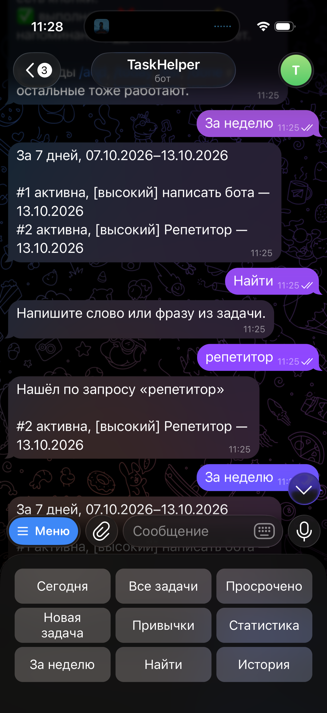
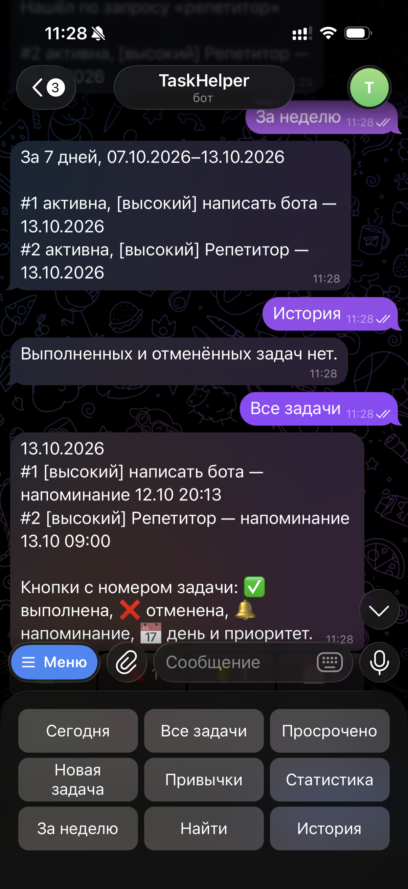
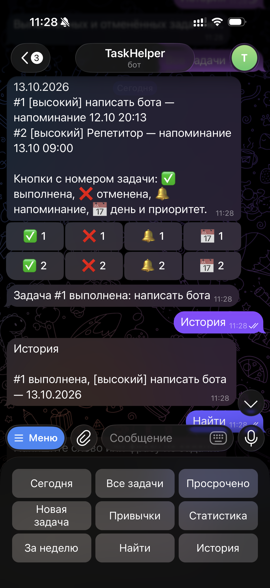
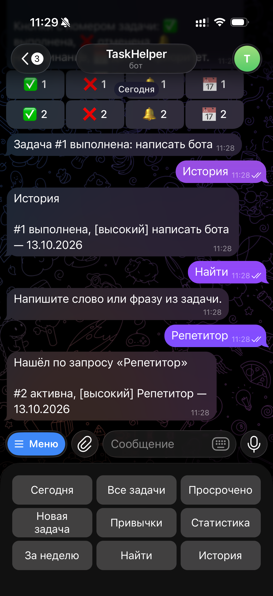

University: [ITMO University](https://itmo.ru/ru/)
Faculty: [FICT](https://fict.itmo.ru)
Course: [Vibe Coding: AI-боты для бизнеса](https://github.com/itmo-ict-faculty/vibe-coding-for-business)
Year: 2025/2026
Group: U4225
Author: Matsukov Artem Sergeevich
Lab: Lab2
Date of create: 13.10.2026
Date of finished:

# Лабораторная работа 2. Подключение бота к данным

## Описание интеграции

Источник данных — SQLite, файл `lab2/bot.db`. Бот первой лабораторной уже хранит задачи и привычки, а в условии второй работы есть пример «покажи мои задачи за последнюю неделю». База позволяет искать и фильтровать эти записи, не подключая внешний сервис.

Сейчас данные лежат в `lab1/tasks.json`. При первом запуске обновлённый бот переносит их в базу и файл не удаляет. Команды и кнопки первой лабораторной сохраняются.

Новые действия: задачи за последние 7 дней, поиск по тексту и история выполненных и отменённых.

## Промпт для LLM

### Исходный промпт

```text
Улучши моего Telegram-бота, добавив работу с базой SQLite.

Текущий бот лежит в lab1/bot.py. Не изменяй файлы в lab1. Новую версию сохрани в папке lab2. Поведение задач, привычек, напоминаний и кнопок из lab1 сохрани.

Текущий функционал бота:
- Личный ассистент дел и привычек, ответы на русском, часовой пояс Europe/Moscow.
- Библиотека python-telegram-bot 22.8 с job-queue, токен из TELEGRAM_BOT_TOKEN через python-dotenv, запуск long polling.
- Задачи: текст, приоритет (высокий, средний, низкий), день ДД.ММ или ДД.ММ.ГГГГ, напоминание, статусы active, done, cancelled. Удаление убирает задачу без следа в статистике. Номера в чате начинаются с 1 и не переиспользуются.
- Списки: сегодня, выбранный день, все активные, просроченные. Просрочена активная задача, у которой день строго раньше сегодня.
- Привычки: создание, отметка и снятие за сегодня, серия дней, статистика за 7 и 30 дней.
- Статистика задач: активные, выполненные, отменённые, просроченные. Просроченные входят в активные.
- Управление кнопками внизу чата и кнопками под списками. Команды тоже работают.
- Сейчас хранение в lab1/tasks.json, данные разделены по id чата.

Новый функционал:
- Хранить задачи и привычки в SQLite, файл lab2/bot.db.
- При первом запуске, если база пустая и рядом или в ../lab1/tasks.json есть читаемый JSON, один раз перенести оттуда задачи, привычки, отметки и next_task_id. Файл JSON не удалять и не изменять. Если база уже не пустая, повторно не импортировать. Если JSON повреждён, не затирать его, написать в лог и запустить бота с той базой, которая есть.
- Кнопка и команда «За неделю» (/week): задачи этого чата, у которых день выполнения или календарная дата создания попадает в последние 7 дней, включая сегодня. Показывать активные, выполненные и отменённые, рядом со статусом. Сортировка: сначала по дню, задачи без дня в конце, внутри дня по приоритету.
- Кнопка «Найти» просит фразу. Команда /find текст ищет сразу. Поиск по подстроке текста задачи без учёта регистра, только в этом чате, по всем статусам. Пустой запрос объясняет, как искать. Если ничего нет, отдельная фраза.
- Кнопка и команда «История» (/history): выполненные и отменённые задачи этого чата, сначала новые. У каждой видны номер, статус, приоритет, текст и день, если он есть.
- В нижнюю клавиатуру добавить третий ряд: «За неделю», «Найти», «История». Старые кнопки не убирать.
- Напоминания по-прежнему ставить через JobQueue и после перезапуска восстанавливать из базы. Прошедшие не отправлять. Выполненная, отменённая или удалённая задача напоминание не получает.

Как работать с данными:
- Использовать стандартный модуль sqlite3, без новой библиотеки.
- Таблица chats: chat_id, next_task_id.
- Таблица tasks: chat_id, task_id, text, priority, due, remind_at, status, created_at. Пара chat_id и task_id уникальна.
- Таблица habits: id, chat_id, name. В одном чате имена без учёта регистра не повторяются.
- Таблица habit_marks: habit_id, mark_date. Пара уникальна.
- Каждая операция открывает соединение, выполняет запрос и закрывает его. Запись делать транзакцией.
- Чужой чат не видит чужие задачи и привычки.

Требования:
- Код должен быть простым и понятным.
- Добавить обработку ошибок базы, пустых команд и отсутствующего файла.
- Хорошие комментарии на русском языке.
- Сохранить существующий функционал lab1: команды, кнопки, приоритеты, дни, напоминания, привычки и статистику.
- Токен по-прежнему только из .env, в код не вписывать.
- bot.db не коммитить: добавь его в .gitignore репозитория, если строки ещё нет.

Создай в папке lab2:

1. Обновлённый bot.py.
2. requirements.txt с теми же зависимостями, что в lab1: python-telegram-bot[job-queue]==22.8 и python-dotenv==1.2.4. Отдельный файл базы не создавать вручную: bot.db появляется при запуске.
3. Обновлённый README.md: как запустить из lab2, зачем SQLite, какие новые команды и кнопки, что старые задачи подхватятся из lab1/tasks.json.
4. .env.example только со строкой TELEGRAM_BOT_TOKEN= без настоящего токена.
```

По этому промпту 13.10.2026 собраны файлы `lab2/bot.py`, `requirements.txt`, `README.md` и `.env.example`.

### Итерации

Правок промпта пока не было: код собран по исходному промпту.

### Финальный промпт

Совпадает с исходным.

## Реализация

Бот по-прежнему отвечает в Telegram, а чтение и запись идут в `lab2/bot.db`. При старте создаются четыре таблицы: `chats`, `tasks`, `habits`, `habit_marks`. Пара `chat_id` и `task_id` уникальна, поэтому номера задач из первой лабораторной сохраняются. Запись выполняется одной транзакцией: если сохранение обрывается, база остаётся прежней.

Если база пустая, бот один раз читает `lab1/tasks.json` и переносит задачи, привычки и отметки. Файл JSON после этого не меняется. Повторный запуск импорт не повторяет.

Выборка за неделю смотрит и день задачи, и дату создания. Окно — сегодня и шесть предыдущих дней.

```python
SELECT task_id, text, priority, due, remind_at, status, created_at
FROM tasks
WHERE chat_id = ?
  AND (
    (due IS NOT NULL AND due >= ? AND due <= ?)
    OR (substr(created_at, 1, 10) >= ? AND substr(created_at, 1, 10) <= ?)
  )
```

История берёт только выполненные и отменённые записи этого чата, сначала новые:

```python
SELECT task_id, text, priority, due, remind_at, status, created_at
FROM tasks
WHERE chat_id = ? AND status IN ('done', 'cancelled')
ORDER BY created_at DESC, task_id DESC
```

Поиск сначала читает задачи чата запросом `SELECT ... FROM tasks WHERE chat_id = ?`, а подстроку сравнивает в Python через `casefold`. Так находится и «репетитор», и «Репетитор». Встроенный `lower()` в SQLite для кириллицы этого не гарантирует.

Библиотеки: `sqlite3` из стандартной поставки Python, `python-telegram-bot` 22.8 с `job-queue`, `python-dotenv` 1.2.4. Отдельный пакет для базы не ставился. Запуск описан в [README.md](README.md).

## Тестирование

Видео-демо: [Google Drive](https://drive.google.com/file/d/1nAbKdQSuIiRuPwxMwm0nTai2a8BAuRL2/view?usp=share_link).

Кнопка «За неделю» вернула две активные задачи на 13.10.2026: «написать бота» и «Репетитор». Период в ответе: 07.10.2026–13.10.2026. Кнопка «Найти» попросила фразу, запрос «репетитор» нашёл только задачу №2.



«История» до отметки выполнения ответила: «Выполненных и отменённых задач нет». Список «Все задачи» при этом показывает обе активные задачи и их напоминания. Пустой ответ здесь верный: история не дублирует активный список.



Задачу №1 отметили выполненной. Следующая «История» показала: «#1 выполнена, [высокий] написать бота — 13.10.2026».



Повторный поиск «Репетитор» с заглавной буквы снова нашёл задачу №2 и подписал её как активную. Выполненная задача №1 в эту выдачу не попала.



Примеры запросов и ответов:

| Запрос | Ответ |
|---|---|
| За неделю | `#1 активна, [высокий] написать бота — 13.10.2026` и `#2 активна, [высокий] Репетитор — 13.10.2026` |
| Найти → `репетитор` | `#2 активна, [высокий] Репетитор — 13.10.2026` |
| История до выполнения | `Выполненных и отменённых задач нет.` |
| История после «выполнено» у №1 | `#1 выполнена, [высокий] написать бота — 13.10.2026` |
| Найти → `Репетитор` | снова только активная задача №2 |

## Трудности и решения

Бота первой и второй лабораторной нельзя держать запущенными вместе: токен один, Telegram принимает только одно подключение. Перед проверкой процесс из `lab1` был остановлен, запущен процесс из `lab2`.

`lower()` в SQLite ненадёжен для русских букв. Поиск читает строки чата обычным SQL-запросом, а регистр сравнивает методом `casefold`. На скриншотах «репетитор» и «Репетитор» дают одну и ту же задачу.

Первый ответ «История» был пустым, хотя задачи на экране уже были. Они ещё имели статус «активна». После кнопки «выполнено» задача сразу появилась в истории. Отдельная выборка по статусам `done` и `cancelled` сработала.

Перенос из JSON сделан только для пустой базы. Иначе повторный запуск продублировал бы те же номера задач.

## Выводы

База заменила JSON-файл и сохранила прежние задачи, привычки, напоминания и кнопки. Поверх этого появились неделя, поиск и история. На скриншотах видно и пустую историю, и появление выполненной задачи, и поиск без учёта регистра.

Удачно получилось не ломать сценарий первой лабораторной: старые кнопки остались, новые стоят третьим рядом. Промпт заранее описал таблицы и правило однократного импорта, поэтому данные из `tasks.json` подхватились при первом запуске.

Дальше можно показывать в «За неделю» отдельные группы по статусу и добавить поиск по привычкам. На защите стоит коротко открыть файл `bot.db` и показать, что те же две задачи лежат в таблице `tasks`.

Чему получилось научиться: описать в промпте структуру таблиц и перенос старых данных, а затем проверить выборки на живых задачах, а не только на пустой базе.

