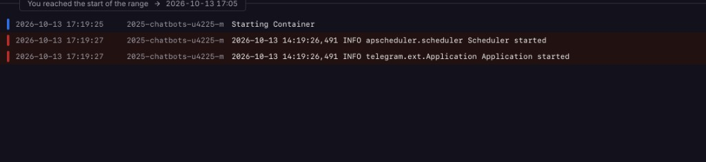
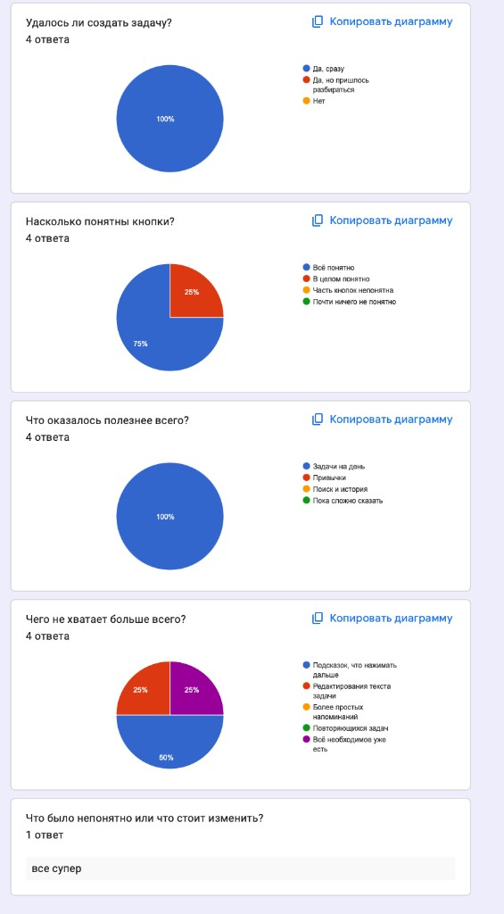

University: [ITMO University](https://itmo.ru/ru/)
Faculty: [FICT](https://fict.itmo.ru)
Course: [Vibe Coding: AI-боты для бизнеса](https://github.com/itmo-ict-faculty/vibe-coding-for-business)
Year: 2025/2026
Group: U4225
Author: Matsukov Artem Sergeevich
Lab: Lab3
Date of create: 13.10.2026
Date of finished:

# Лабораторная работа 3. Деплой и обратная связь

## Описание деплоя

Бот `@itmoftmi_matsukovas_bot` запущен на [Railway](https://railway.app), бесплатный план. Репозиторий `durilich/2025-chatbots-u4225-matsukov_a_s`, ветка `main`, корневая папка сервиса `lab2`. Регион US East, одна реплика.

Процесс тот же, что на компьютере: `python bot.py`. Бот сам опрашивает Telegram, поэтому отдельный сайт и webhook не нужны. В панели Railway сервис остаётся без публичного адреса. Токен записан переменной `TELEGRAM_BOT_TOKEN` и в репозиторий не входит.

Для запуска в репозитории лежат два файла. `lab2/Procfile` указывает команду `worker: python bot.py`. `lab2/railway.toml` задаёт сборку Nixpacks и ту же команду старта.

База на сервере — файл `bot.db` рядом с ботом. В git его нет, поэтому задачи с компьютера на сервер не переносятся. У каждого чата свой `chat_id`: человек с другого аккаунта видит только свои задачи.

## Процесс деплоя

1. В Railway вход через GitHub под аккаунтом `durilich`.
2. New Project → Deploy from GitHub repo → `2025-chatbots-u4225-matsukov_a_s`.
3. В Settings → Source указана Root Directory `lab2`.
4. В Variables добавлена `TELEGRAM_BOT_TOKEN`.
5. В логах появилась строка `Application started`. После этого бот ответил на `/start` в Telegram, компьютер можно было выключить.

Первый успешный запуск: 13.10.2026, 17:19 по Москве.



Правка по отзывам ушла коммитом `1094190`. Railway сам её не подхватил: активным оставался деплой «Update README.md». Новая версия появилась после Settings → Source → Check for updates → Update. В логах снова была строка `Application started`, в Telegram появились подсказка и кнопка «Текст».

## Промпт улучшения

Исходный бот уже был собран в лабораторных 1 и 2. Для третьей работы отдельный промпт описывает только правки по отзывам.

```text
По отзывам четырёх человек измени поведение бота в lab2/bot.py. Команды, кнопки и хранение в SQLite сохрани.

1. Подсказка следующего шага. После /start и после сохранения задачи бот пишет одну короткую строку, что нажать дальше. Если активных задач нет, строка «Дальше нажмите «Новая задача»». Если задачи уже есть, «Дальше нажмите «Сегодня»». Сразу после сохранения добавь «Дальше нажмите «Сегодня», чтобы увидеть её».
2. Правка текста. Под задачей, рядом с кнопками выполнения и даты, добавь кнопку «Текст N». Бот просит новый текст и сохраняет только его. Номер, день, приоритет и напоминание не меняются. Пустой текст не записывай.

Ответы на русском. Токен по-прежнему только из переменной окружения.
```

По этому описанию 13.10.2026 изменён `lab2/bot.py`.

## Обратная связь

Отзывы собраны короткой формой Google. Перед ответом человека просили открыть бота, создать задачу на сегодня и отметить привычку. Ответили 4 человека.

Вопросы с вариантами:

- Удалось ли создать задачу?
- Насколько понятны кнопки?
- Что оказалось полезнее всего?
- Чего не хватает больше всего?

Один свободный вопрос: «Что было непонятно или что стоит изменить?»



| Вопрос | Результат |
|---|---|
| Удалось ли создать задачу? | 4 из 4: «Да, сразу» |
| Насколько понятны кнопки? | 3 из 4: «Всё понятно»; 1 из 4: «В целом понятно» |
| Что оказалось полезнее всего? | 4 из 4: «Задачи на день» |
| Чего не хватает больше всего? | 2 из 4: подсказки, что нажимать дальше; 1 из 4: редактирование текста; 1 из 4: всё необходимое уже есть |
| Свободный ответ | один ответ: «все супер» |

Создание задачи уже получалось сразу, а список на день оказался главной функцией. Менять кнопки и привычки повод не было. Два человека попросили подсказку следующего шага, один — правку текста задачи.

## Улучшения

По двум конкретным просьбам изменён `lab2/bot.py`.

После `/start` бот смотрит, есть ли активные задачи в этом чате. Пустой чат получает «Дальше нажмите «Новая задача»». Чат с задачами получает «Дальше нажмите «Сегодня»». Успешное добавление задачи дописывает «Дальше нажмите «Сегодня», чтобы увидеть её».

Под каждой задачей в списке есть кнопка «Текст N». Новый текст записывается в ту же строку базы. Номер, день, приоритет, напоминание и статус не читаются из сообщения и не пересчитываются.

```python
task["text"] = new_text
store.save(data)
return f"Обновил текст задачи #{task_id}: {new_text}."
```

После деплоя коммита `1094190` это проверено в Telegram: `/start` заканчивается подсказкой, ответ о новой задаче ведёт на «Сегодня», кнопка «Текст» меняет формулировку и оставляет номер и день.

## Трудности и решения

Первая сборка упала на шаге Build image. Railpack показал корень репозитория: папки `lab2`, `lab3` и `Скрины`, без `requirements.txt`. Корень сервиса ещё не был задан. После Root Directory `lab2` сборка нашла `bot.py` и зависимости, в логе появилось `Application started`.

Автодеплой в панели был недоступен, список веток не загружался. Коммит с правками бота лежал на GitHub, а активным оставался деплой «Update README.md». Бот отвечал старым текстом справки, без слова «Текст». Кнопка Check for updates показала «New version of the upstream repo available», и только Update запустил нужный коммит.

Локальный `python bot.py` и процесс на Railway нельзя держать вместе: токен один. На время проверки серверной копии локальный процесс был остановлен.

База на сервере отдельная от файла на компьютере. Другой аккаунт Telegram получает свой пустой список. Это ожидаемое поведение: строки задач хранятся с `chat_id` чата.

## Выводы

Бот работает без включённого компьютера. Запуск — long polling из папки `lab2`, токен только в переменных Railway. Первый успешный лог — `Application started` 13.10.2026 в 17:19.

Четыре человека смогли создать задачу сразу. Полезнее всего для них оказались задачи на день. По двум просьбам добавлены подсказка следующего шага и кнопка «Текст». После отдельного обновления сервиса эти ответы видны в Telegram.

Удачно получилось не поднимать webhook: бот уже сам ходит в Telegram, серверу достаточно одной команды `python bot.py`. Форма собрала ответы быстрее, чем переписка, и по ней видно, что менять, а что оставить.

Дальше имеет смысл следить за расходом бесплатного кредита Railway, пока идёт проверка преподавателем. На защите стоит открыть лог с `Application started` и в том же боте показать подсказку после `/start` и кнопку «Текст».

Чему получилось научиться: вынести уже работающего бота на сервер через корневую папку и переменную окружения, а затем поменять его по ответам живых людей, а не по своему предположению.
